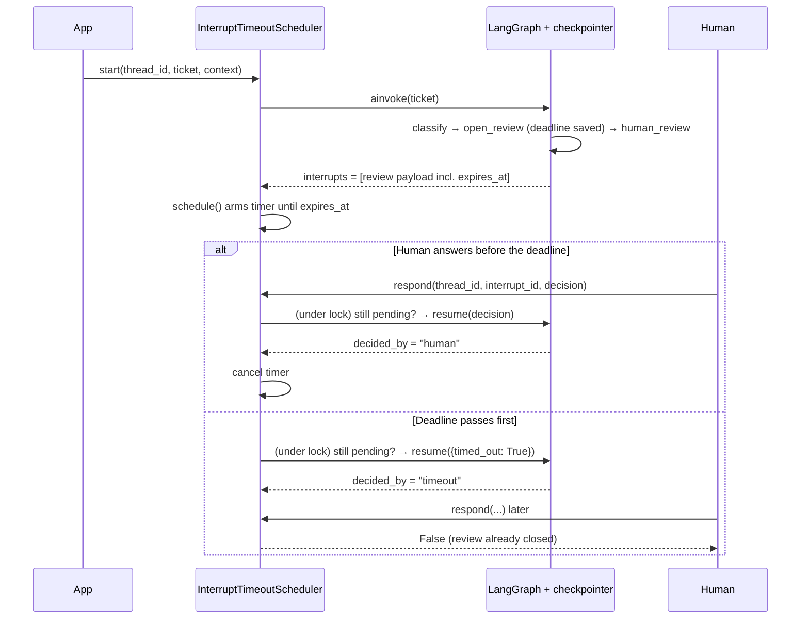

# LangGraph interrupt timeouts

A triage agent pauses with `interrupt()` for human review. If nobody responds
within a configurable window, it resumes on its own with a default decision.

```bash
uv sync
uv run main.py   # three scenarios with a live countdown (10s timeout)
uv run pytest
```

## Does LangGraph support this natively?

**No.** As of `langgraph` 1.2.12:

- `interrupt(value, *, response_schema=None)` has no timeout or deadline
  parameter ([interrupts docs](https://docs.langchain.com/oss/python/langgraph/interrupts)).
- Node `TimeoutPolicy` (`run_timeout` / `idle_timeout`) only bounds a node *while
  it executes*. Interrupts also bypass retry policies and error handlers
  ([fault tolerance docs](https://docs.langchain.com/oss/python/langgraph/fault-tolerance)).

When a graph interrupts, the run **ends** and its state is written to the
checkpointer. A paused thread is just a row in a database. No process is
waiting on it, so there's nothing inside the graph that could notice a deadline
passing. The timeout therefore has to be driven from **outside the graph**:
something must remember the deadline, wake up when it passes, and send the
resume command itself.

## How the timeout works

### The pieces

| Piece | Where | Responsibility |
| --- | --- | --- |
| `open_review` node | `triage/graph.py` | Computes the deadline and saves it in graph state |
| `human_review` node | `triage/graph.py` | Calls `interrupt()`, then applies either the human's decision or the default |
| `InterruptTimeoutScheduler` | `triage/timeouts.py` | Arms a timer per pending interrupt and resumes the thread when it expires |
| `_resume_if_pending` | `triage/timeouts.py` | Guard that guarantees only one of human or timer resumes a given review |

The split is deliberate: **the graph owns the policy** (what the deadline is,
what the default is) and **the scheduler owns the clock** (when to fire). The
scheduler never decides what the default route is, and the graph never sleeps.

### Lifecycle



### Step 1: Save the deadline in graph state

The deadline is computed in its own node, **before** the node that interrupts.

```python
# triage/graph.py

@dataclass
class TriageContext:
    # Per-run setting, passed with `context=TriageContext(...)` when invoking.
    review_timeout_seconds: float = 300.0


def open_review(state: TicketState, runtime: Runtime[TriageContext]) -> dict:
    timeout_seconds = runtime.context.review_timeout_seconds
    expires_at = datetime.now(UTC) + timedelta(seconds=timeout_seconds)
    review: PendingReview = {
        # Unique id for this review. Every resume value must carry it, so a
        # decision meant for one review can never close a different one.
        "review_id": uuid.uuid4().hex,
        # Absolute deadline (not "N seconds from now"), so anyone reading it
        # later (the scheduler, a UI, a process after a restart) computes the
        # same remaining time.
        "expires_at": expires_at.isoformat(),
        "timeout_seconds": timeout_seconds,
        # The default is decided now, while we know the proposed route.
        "default_route": state["proposed_route"],
    }
    # Returning it as a state update means it is written to the checkpoint.
    return {"review": review}
```

Why a separate node instead of computing the deadline inside `human_review`?
When a graph resumes, **the interrupted node re-runs from its first line**. If
`human_review` called `datetime.now()` itself, every resume would produce a
new deadline and a new `review_id`. Putting them in an earlier node's state
update means they are computed once and stay fixed.

### Step 2: Interrupt, then apply the human's decision or the default

```python
# triage/graph.py

def timeout_decision(review_id: str) -> ReviewDecision:
    # The resume value the scheduler sends when the deadline passes.
    return {"review_id": review_id, "timed_out": True}


def human_review(state: TicketState) -> Command:
    review = state["review"]

    # Pause. The payload includes expires_at / default_route so the scheduler
    # (and any UI showing a countdown) can read the deadline from the interrupt.
    decision = interrupt(
        {
            **review,
            "ticket": state["ticket"],
            "severity": state["severity"],
            "allowed_routes": list(get_args(Route)),
        }
    )

    # Execution reaches here only after a Command(resume=...). Ignore any
    # resume value that doesn't belong to the review currently open.
    is_for_this_review = (
        isinstance(decision, dict) and decision.get("review_id") == review["review_id"]
    )

    # Timeout path: nobody answered, so apply the default chosen in open_review.
    if is_for_this_review and decision.get("timed_out"):
        return Command(
            update={"route": review["default_route"], "decided_by": "timeout"}, goto=END
        )

    # Human path: accept the human's route if it is a valid one.
    if is_for_this_review and decision.get("route") in get_args(Route):
        return Command(update={"route": decision["route"], "decided_by": "human"}, goto=END)

    # Anything else (stale or malformed): loop back and interrupt again with the
    # same review, which keeps the same deadline because it lives in state.
    return Command(goto="human_review")
```

The default behavior lives **inside the graph**, not in the scheduler. The
scheduler only says "time's up". The graph decides what that means and records
`decided_by="timeout"`, so the automatic decision is visible in state and in
traces.

### Step 3: Arm a timer whenever the graph pauses

Every time the scheduler runs the graph, it looks at the interrupts the run
ended on and arms a timer for each one.

```python
# triage/timeouts.py

async def _run(
    self, thread_id: str, graph_input: TicketInput | Command, context: TriageContext
) -> tuple[Interrupt, ...]:
    output = await self._graph.ainvoke(
        graph_input, _thread_config(thread_id), context=context, version="v2"
    )
    # version="v2" returns a GraphOutput whose .interrupts lists every
    # interrupt the run paused on. Arm a timer for each.
    for pending in output.interrupts:
        self.schedule(thread_id, pending)
    return output.interrupts


def schedule(self, thread_id: str, pending: Interrupt) -> None:
    # One timer per interrupt id; scheduling the same interrupt twice is a no-op.
    if pending.id in self._timers:
        return
    self._timers[pending.id] = asyncio.create_task(self._expire(thread_id, pending))
```

Because `_run` is used for both the first run and every resume, a graph that
pauses again later (for example, `human_review` re-interrupting after a stale
decision) automatically gets a new timer.

### Step 4: When the timer expires, resume with the timeout decision

```python
# triage/timeouts.py

def _seconds_until(expires_at: str) -> float:
    return (datetime.fromisoformat(expires_at) - datetime.now(UTC)).total_seconds()


async def _expire(self, thread_id: str, pending: Interrupt) -> bool:
    # Sleep until the absolute deadline read from the interrupt payload. If the
    # deadline has already passed (e.g. after a restart), fire immediately.
    await asyncio.sleep(max(0.0, _seconds_until(pending.value["expires_at"])))

    # Remove ourselves first, so a concurrent respond() can't cancel this task
    # partway through resuming the graph.
    self._timers.pop(pending.id, None)

    # Go through the same guarded path the human uses.
    return await self._resume_if_pending(
        thread_id, pending.id, timeout_decision(pending.value["review_id"])
    )
```

### Step 5: Make sure only one side resumes

The human and the timer can race. Without a guard, both could resume the
thread. That matters because **LangGraph does not reject a stale resume**:

- If `Command(resume={interrupt_id: value})` names an interrupt that is no longer
  pending, LangGraph delivers the whole dict as the resume value to whatever
  interrupt *is* pending.
- Resuming a thread that has already finished is a silent no-op.

So the scheduler checks before it resumes:

```python
# triage/timeouts.py

async def _resume_if_pending(
    self, thread_id: str, interrupt_id: str, decision: ReviewDecision
) -> bool:
    # Per-thread lock: the human and the timer can't both be between the
    # "is it pending?" check and the resume at the same time.
    async with self._locks[thread_id]:
        # Read the thread's checkpoint and see what it is waiting on right now.
        pending_ids = {i.id for i in await self.pending_interrupts(thread_id)}

        # Someone already resumed this interrupt; the other side loses.
        if interrupt_id not in pending_ids:
            return False

        # Resume by interrupt id, so the value goes to exactly this interrupt.
        await self._run(thread_id, Command(resume={interrupt_id: decision}), TriageContext())
        return True
```

The `review_id` check in `human_review` (step 2) is a second layer: even if a
stale decision somehow reached the graph, it would be ignored and the node
would interrupt again.

### Step 6: The human's path

```python
# triage/timeouts.py

async def respond(self, thread_id: str, interrupt_id: str, decision: ReviewDecision) -> bool:
    """Deliver a human decision. Returns False if the review already closed."""
    resumed = await self._resume_if_pending(thread_id, interrupt_id, decision)

    # Only cancel the timer if the human actually won. If the timer won, it has
    # already removed itself, so there's nothing to cancel.
    if resumed:
        self.cancel(interrupt_id)
    return resumed
```

The `False` return value is how the caller learns the human was too late, so
it can tell the reviewer the default was already applied.

### Step 7: Surviving a restart

Timers are in-memory asyncio tasks, so they disappear if the process restarts.
The deadline doesn't, because it lives in the checkpoint. `rehydrate()` rebuilds
the timers from it:

```python
# triage/timeouts.py

async def rehydrate(self, thread_ids: Iterable[str]) -> None:
    """Re-arm timers after a restart from deadlines stored in the checkpoints."""
    for thread_id in thread_ids:
        # Ask each thread what it is waiting on. Each pending interrupt carries
        # expires_at in its payload, so schedule() can compute the remaining time.
        for pending in await self.pending_interrupts(thread_id):
            self.schedule(thread_id, pending)
```

Reviews whose deadline passed while the process was down fire immediately,
because `_expire` clamps a negative wait to zero. The caller provides the thread
ids, typically from the application's own table of tickets awaiting review.

### Using it

```python
from langgraph.checkpoint.sqlite.aio import AsyncSqliteSaver

from triage.graph import TriageContext, build_graph
from triage.timeouts import InterruptTimeoutScheduler

async with AsyncSqliteSaver.from_conn_string("checkpoints.sqlite") as checkpointer:
    graph = build_graph(checkpointer)
    scheduler = InterruptTimeoutScheduler(graph)

    # On boot: re-arm timers for any reviews left open by a previous process.
    await scheduler.rehydrate(open_ticket_thread_ids)

    # Run until the graph pauses for review; a 10s timer is armed automatically.
    (pending,) = await scheduler.start(
        "ticket-123",
        {"ticket": "Checkout is down for EU"},
        TriageContext(review_timeout_seconds=10),
    )

    # Later, when the reviewer submits. Returns False if the timeout won.
    accepted = await scheduler.respond(
        "ticket-123",
        pending.id,
        {"review_id": pending.value["review_id"], "route": "eng_queue"},
    )
```

### Outcomes at a glance

| What happens | Result | `decided_by` | `respond()` returns |
| --- | --- | --- | --- |
| Human answers before the deadline | Human's route | `human` | `True` (timer cancelled) |
| Nobody answers | `default_route` | `timeout` | n/a |
| Human answers after the deadline | `default_route` (unchanged) | `timeout` | `False` |
| Process restarts while a review is open | Timer re-armed by `rehydrate()`; fires at the original deadline | `timeout` (if no answer) | n/a |
| Decision with wrong `review_id` reaches the graph | Ignored; node interrupts again with the same deadline | unset | n/a |

## Agent Server variant

On LangSmith Agent Server, no custom scheduler is needed: creating a run
accepts `after_seconds`. When the graph pauses, `agent_server/client_example.py`
schedules a delayed run on the thread that resumes with the timeout decision,
and cancels it if the human answers first. The graph is unchanged.

```bash
uv run langgraph dev --no-browser
uv run python -m agent_server.client_example
```

## Files

| File | Purpose |
| --- | --- |
| `triage/graph.py` | Triage graph (`classify` → `open_review` → `human_review`) |
| `triage/timeouts.py` | `InterruptTimeoutScheduler`: in-process timer, race guard, `rehydrate()` after restart |
| `main.py` | Demo: human in time, nobody answers, human too late |
| `agent_server/client_example.py` | Same three scenarios on Agent Server via `after_seconds` + `runs.cancel` |
| `tests/test_timeouts.py` | Human wins, timeout wins, late human, stale id, restart rehydration |

## Production notes

- **Which scheduler.** The in-process asyncio timer is the reference. The
  contract (`schedule` on pause, guarded resume on expiry, `rehydrate` on boot)
  maps directly onto Celery ETA tasks, Temporal timers, or a cron that polls a
  table of open reviews by `expires_at`. On Agent Server, prefer the delayed-run
  approach so no extra infrastructure is needed.
- **Multiple workers.** The per-thread `asyncio.Lock` only serializes within one
  process. Across workers, use a DB row / advisory lock keyed on thread id (or
  rely on Agent Server, which serializes runs per thread).
- **Rehydration.** `rehydrate()` takes thread ids the app knows are awaiting
  review (e.g. from its tickets table). Deadlines are read from checkpoints, so
  expired reviews fire immediately on boot.
- **Timer precision.** The default fires at or shortly after `expires_at`,
  never before.
- **Agent Server race.** If the human responds just as the delayed run starts,
  `runs.cancel` returns 404 or the run has already resumed. The client re-checks
  pending interrupts, and the graph's `review_id` check protects any later
  review on the same thread from a stale timeout.
